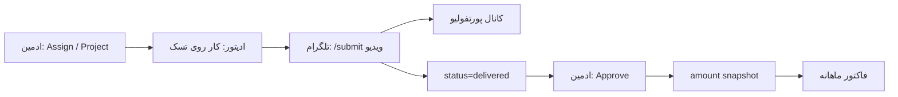

# Edit Team Hub — طراحی فعلی سیستم

**نسخه سند:** هم‌تراز با کد فعلی پروژه (2026-11)  
**مخاطب:** تیم محصول / توسعه برای درک معماری و جریان‌ها

---

## 1. خلاصه محصول

پلتفرم داخلی مدیریت کار تیم ادیت ویدیو با دو سطح دسترسی کاملاً جدا:

| پورتال | نقش‌ها | هدف |
|---|---|---|
| **ادمین** (`/admin`) | `owner`, `admin` | اختصاص تسک، تأیید، پروژه/قیمت، فاکتور، تنظیمات |
| **ادیتور** (`/week` …) | `editor` | دیدن/انجام تسک‌های خود، آمار شخصی، فاکتور خودش |

- منبع حقیقت: یک Postgres مشترک برای وب و ربات
- منطق کسب‌وکار فقط در `packages/core` (وب و بات مستقیم به DB برای mutation نمی‌نویسند)
- فایل ویدیو روی سرور ذخیره نمی‌شود؛ آپلود فقط در تلگرام و انتشار به کانال با `copyMessage` / `file_id`

---

## 2. معماری کلی

```
┌─────────────┐     ┌─────────────┐
│  apps/web   │     │  apps/bot   │
│  Next.js    │     │  grammY     │
└──────┬──────┘     └──────┬──────┘
       │                   │
       └─────────┬─────────┘
                 ▼
         ┌───────────────┐
         │ packages/core │  permissions, tasks, billing, invites …
         └───────┬───────┘
                 ▼
         ┌───────────────┐
         │  packages/db  │  Drizzle + Postgres
         └───────────────┘

کمکی:
  packages/telegram     کپشن، escape، deep-link
  packages/invoice-pdf  HTML/PDF فاکتور (Playwright)
```

### قوانین معماری

1. هر mutation از مسیر `core` + `permissions.can()` می‌گذرد.
2. هر mutation یک ردیف `activity_log` می‌نویسد (`source = web | bot | system`).
3. رویداد realtime: `pg_notify('events')` → SSE در `/api/events`.
4. وب و بات نباید منطق جدا برای وضعیت/دسترسی داشته باشند.

---

## 3. نقش‌ها و دسترسی

| قابلیت | owner | admin | editor |
|---|---|---|---|
| دیدن همه تسک‌ها / برد تیم | ✓ | ✓ | ✗ (فقط خود) |
| Assign تسک | ✓ | ✓ | ✗ |
| Approve / Reject | ✓ | ✓ | ✗ |
| مدیریت پروژه و قیمت | ✓ | ✓ | ✗ |
| دعوت عضو | ✓ | ✓ | ✗ |
| Promote/Demote ادمین | ✓ | ✗ | ✗ |
| دیدن درآمد همه | ✓ | ✓ | فقط خودش |
| صدور / پرداخت فاکتور | ✓ | ✓ | ✗ |
| Submit deliverable (ربات) | ✓ | ✓ | ✓ (تسک خودش) |

**جداسازی پورتال وب**

- ورود با تب `ادمین` فقط برای `owner|admin` → ریدایرکت به `/admin`
- ورود با تب `ادیتور` فقط برای `editor` → ریدایرکت به `/week`
- ادمین نمی‌تواند وارد فضای ادیتور شود و برعکس

---

## 4. احراز هویت وب

```
آیدی عددی تلگرام + رمز عبور
        ↓
POST /api/auth/login  (+ portal=admin|editor)
        ↓
بررسی نقش ↔ پورتال
        ↓
JWT در کوکی httpOnly: eth_session
```

- هش رمز: `scrypt` (`salt:hash`) در ستون `users.password_hash`
- Owner اولیه از `OWNER_TELEGRAM_ID` + `OWNER_PASSWORD` در seed
- عضو جدید از ربات با invite: رمز اولیه = کد دعوت
- ادمین می‌تواند در Settings رمز اعضا را عوض کند

---

## 5. مدل دامنه (خلاصه)

### کاربران و عضویت
- `users` — telegram_id، نقش، password_hash
- `invite_codes` — یک‌بارمصرف، انقضای ۴۸س

### طبقه‌بندی کار
- `categories` — حوزه ادیت (املاک، فشن، …)
- `clients` — کارفرما

### پروژه و پول
- `projects` — قیمت واحد (`unit_price` به تومان صحیح / bigint)، وضعیت open/closed
- `project_members` — ادیتورهای مجاز + `rate_override` اختیاری

### تسک
- `tasks` — short_code (`T-0001`)، وضعیت، week_key (ISO)، project_id، units
- روی approve: `unit_price_snapshot` و `amount` قفل می‌شود
- بعد از فاکتور: `invoice_id` ست می‌شود و تسک قفل ویرایش است

### تحویل
- `deliverables` — فقط متادیتا + `tg_file_id` / `channel_msg_id` (بدون بایت ویدیو روی سرور)

### فاکتور
- `invoices` — دوره میلادی `YYYY-MM`، unique(user_id, period_key)
- `invoice_lines` — اسنپ‌شات پروژه/مبلغ هر تسک

### زیرساخت بات
- `bot_sessions` — state مکالمه grammY
- `tg_processed_updates` — idempotency وبهوک

---

## 6. چرخه عمر تسک

```
todo → in_progress → delivered → approved
                       │
                       └→ rejected → in_progress
```

- `delivered` معمولاً با `/submit` در تلگرام ست می‌شود
- `approved` / `rejected` فقط ادمین (وب یا دکمه اینلاین بات)
- آمار هفتگی بر اساس `week_key` (مثلاً `2026-W46`)

---

## 7. پروژه‌ها، درآمد و فاکتور

1. ادمین پروژه می‌سازد (قیمت واحد + انتخاب ادیتورها).
2. تسک زیر پروژه با `units` ساخته می‌شود.
3. با Approve:  
   `rate = rate_override ?? project.unit_price`  
   `amount = units × rate` (اسنپ‌شات؛ تغییر قیمت بعدی روی گذشته اثر ندارد).
4. درآمد ماهانه = تسک‌های `approved` در ماه میلادی (Asia/Tehran).
5. جاب ماهانه (`cron-invoices`) روی روز ۱ ماه، ماه قبل را فاکتور می‌کند (idempotent).
6. Issue → ارسال PDF به ادیتور در تلگرام؛ Mark paid → فقط‌خواندنی.

پول همیشه `bigint` تومان است؛ در UI با ارقام فارسی و جداکننده نمایش داده می‌شود.

---

## 8. طراحی UI وب

مبنای بصری: Stitch Design System (`edit_team_hub_2`) — تم moss-dark سینمایی.

### جهت و تم
- RTL (`dir="rtl"`، `lang="fa"`)
- سطوح: `surface-base` `#0d1410` → `surface-card` `#18261e` → `surface-raised` `#1a2e22`
- Primary: `#4edea3` / container `#10b981` — border-glass emerald
- وضعیت‌ها: todo / in_progress / delivered / approved / rejected با رنگ اختصاصی
- فونت: IBM Plex Sans (+ Vazirmatn) + Material Symbols Outlined
- توکن‌ها در `apps/web/app/globals.css`

### ساختار صفحات

**ورود** `/login?portal=admin|editor`
- کارت احراز هویت با segmented portal switcher
- فرم شناسه عددی تلگرام + رمز/کد دعوت
- لینک بات تلگرام برای پشتیبانی

**فضای ادمین** (سایدبار RTL ثابت + topbar)

| مسیر | کاربرد |
|---|---|
| `/admin/board` | کانبان + KPI متریک + Assign |
| `/admin/projects` | پروژه و قیمت و اعضا |
| `/admin/earnings` | درآمد همه ادیتورها |
| `/admin/invoices` | صدور / پرداخت / void |
| `/admin/portfolio` | جدول تحویل‌ها |
| `/admin/settings` | دسته، کارفرما، دعوت، رمز، سربرگ فاکتور |
| `/admin/tasks/[id]` | جزئیات تسک |

**فضای ادیتور** (`EditorShell` + topbar)

| مسیر | کاربرد |
|---|---|
| `/week` | تسک‌های هفته + متریک + افزودن تسک |
| `/earnings` | فقط درآمد خودش |
| `/invoices` | فقط فاکتورهای خودش |
| `/portfolio` | مشاهده پورتفولیو |
| `/tasks/[id]` | جزئیات تسک خودش |

مسیرهای قدیمی `/board` و `/projects` و `/settings` به `/admin/...` ریدایرکت می‌شوند.

### کامپوننت‌های کلیدی
- `AdminNav` — سایدبار مدیریت
- `EditorShell` / `EditorNav` — شل میز کار ادیتور
- `RealtimeRefetch` — گوش به SSE و `router.refresh()`
- چیپ وضعیت تسک: `todo | in_progress | delivered | approved | rejected`

---

## 9. ربات تلگرام (طراحی رفتاری)

| دستور | نقش | کار |
|---|---|---|
| `/start <code>` | همه | عضویت با invite |
| `/my` `/add` `/submit` `/week` | ادیتور | تسک و تحویل |
| `/tasks` `/assign` `/done` | ادمین | مدیریت تسک |
| `/approve` `/reject` | ادمین | تأیید |
| `/invite` `/project` | ادمین | دعوت / پروژه |
| `/earnings` `/invoices` `/invoice` | وابسته به نقش | مالی |
| `/report` | ادمین | گزارش هفتگی |
| `/promote` `/demote` | owner | نقش |

جریان Submit: انتخاب تسک → متادیتا → دریافت ویدیو → Preview → `copyMessage` به کانال → `delivered` → نوتیف ادمین با Approve/Reject.

حالت توسعه: long polling (`BOT_MODE=polling`)  
پروداکشن: webhook + secret token

---

## 10. ساختار ریپو

```
apps/
  web/                 پنل Next.js (App Router)
  bot/                 ربات grammY
packages/
  db/                  schema + migrations + seed/seed-demo
  core/                قوانین کسب‌وکار
  telegram/            helperهای متن تلگرام
  invoice-pdf/         ساخت PDF فاکتور
docker-compose.yml     postgres (+ web/bot برای دیپلوی)
DESIGN.md              این سند
README.md              راه‌اندازی اجرایی
```

---

## 11. داده تستی (دمو)

```bash
pnpm db:seed:demo
```

می‌سازد:
- ۱ ادمین تست + ۳ ادیتور (`password = test1234`)
- ۳ پروژه دمو با قیمت و اعضا
- تسک‌هایی در وضعیت‌های مختلف + چند approved با مبلغ

جزئیات لاگین در خروجی ترمینال همان دستور چاپ می‌شود.

---

## 12. محدودیت‌های عمدی MVP

- آپلود ویدیو از وب فعال است (`/api/tasks/[id]/submit`) با progress؛ سقف حدود ۴۹MB به‌خاطر Bot API
- فایل‌های حجیم: دکمه deep-link در صفحه تسک → `/start submit_T-xxxx` روی ربات (بدون محدودیت آپلود سرور)
- چند‌تیمی / SaaS / درگاه پرداخت آنلاین نیست
- فاکتور PDF روی دیسک نگه داشته نمی‌شود؛ از DB بازتولید می‌شود
- پورتال ادمین و ادیتور UI جدا دارند ولی یک دیتابیس و یک هویت دارند

---

## 13. نقشه ذهنی جریان اصلی



این سند وضعیت **پیاده‌سازی فعلی** را توصیف می‌کند، نه wishlist آینده.
